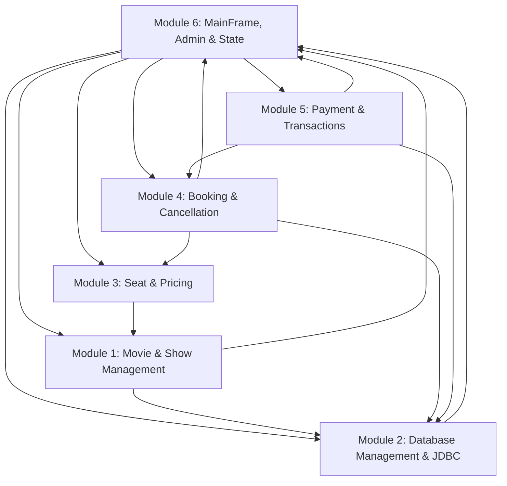

# CineBook — Movie Ticket Booking System
## Refactored Six-Member Modular Java Swing Desktop Application

CineBook is a desktop movie ticket booking system built using Java Swing, standard Java SE libraries, and an embedded SQLite database accessed via the Java Database Connectivity (JDBC) API. The codebase is organized into **six team modules** corresponding to a clean functional division of responsibilities:

1. **Member 1 — Movie, Show & Schedule Management**
2. **Member 2 — Database Management & Relational Persistence (JDBC / SQLite)**
3. **Member 3 — Seat Selection & Pricing**
4. **Member 4 — Booking & Cancellation**
5. **Member 5 — Payment & Transaction Management**
6. **Member 6 — Main UI, Application Integration, Authentication & Administration**

---

## 1. Quick Start & Execution

The application uses standard Java SE with SQLite JDBC integration (driver located in `lib/sqlite-jdbc-3.47.2.0.jar`).

### Step 1: Open Terminal in Project Root
```bash
cd "c:\Users\Admin\Desktop\Joseph\OOP Project"
```

### Step 2: Compile the Entire Application
```bash
javac -cp ".;lib/*" CineBookApp.java
```
*Compiling `CineBookApp.java` with the SQLite JDBC driver resolves and compiles all 47 modular source files.*

### Step 3: Run the Application
```bash
java -cp ".;lib/*" CineBookApp
```
*Executes the 6-step regression verification suite in the console, initializes the SQLite database schema in `db/cinebook.db` if needed, and prompts the interactive Login Dialog before opening the main interface.*

### Default Login Credentials
| Username | Password | Role | Description |
|---|---|---|---|
| `admin` | `123` | Administrator | Full management console, movie/show scheduling & audit reports |
| `user1` | `123` | Customer | Browse movies, select seats, book tickets & view booking history (Aarav Sharma) |
| `user2` | `123` | Customer | Browse movies, select seats, book tickets & view booking history (Diya Patel) |

### Optional: Run Headless Verification Only (Automated Testing)
```bash
java -cp ".;lib/*" CineBookApp --test-only
```

---

## 2. Six Team Member Modules & Source File Ownership

```
CineBook/
├── Movie.java                        [Module 1: Movie domain model]
├── MovieService.java                 [Module 1: Catalogue searching, filtering & movie CRUD]
├── MoviePanel.java                   [Module 1: Screen 1 movie catalogue browsing UI]
├── Show.java                         [Module 1: Screening & showtime model]
├── Screen.java                       [Module 1: Theater auditorium/screen configuration]
├── ShowService.java                  [Module 1: Showtime scheduling, querying & removal]
├── MovieDetailsPanel.java            [Module 1: Screen 2 show selection & timeslots UI]
│
├── DatabaseManager.java              [Module 2: SQLite JDBC manager, connection pool, schema DDL & CRUD]
│                                     [Module 2: Table definitions: users, movies, screens, shows, bookings, txns]
│                                     [Module 2: Parameterized PreparedStatement queries & ResultSet mapping]
│
├── Seat.java                         [Module 3: Seat entity with pricing tier multiplier]
├── SeatStatus.java                   [Module 3: AVAILABLE, SELECTED, RESERVED, BOOKED]
├── SeatCategory.java                 [Module 3: STANDARD, PREMIUM, VIP tiers]
├── SeatManager.java                  [Module 3: Seat state transitions, holds & expiry]
├── SeatSelectionPanel.java           [Module 3: Screen 3 interactive seating grid & live totals]
│
├── Booking.java                      [Module 4: Booking record model]
├── BookingStatus.java                [Module 4: PENDING, CONFIRMED, FAILED, CANCELLED]
├── Cancellable.java                  [Module 4: Cancellation contract interface]
├── BookingService.java               [Module 4: Reservation, confirmation & refund logic]
├── BookingHistoryPanel.java          [Module 4: Screen 6 my bookings & e-ticket modal]
├── BookingConfirmationPanel.java     [Module 4: Screen 5 confirmation receipt UI]
│
├── PaymentStatus.java                [Module 5: Payment status lifecycle enum]
├── PaymentMethod.java                [Module 5: Abstract payment strategy base]
├── MockCardPayment.java              [Module 5: Credit/Debit card simulation]
├── MockUpiPayment.java               [Module 5: UPI Instant pay simulation]
├── MockWalletPayment.java            [Module 5: Digital wallet simulation]
├── PaymentGateway.java               [Module 5: Payment gateway interface]
├── LegacyBankGatewayApi.java         [Module 5: Third-party legacy banking API]
├── LegacyBankResult.java             [Module 5: Legacy bank response structure]
├── LegacyBankGatewayAdapter.java     [Module 5: Adapter design pattern implementation]
├── PaymentTransaction.java           [Module 5: Financial ledger transaction record]
├── PaymentProcessor.java             [Module 5: Payment execution coordinator]
├── CheckoutPanel.java                [Module 5: Screen 4 checkout & outcome simulator]
│
├── CineBookApp.java                  [Module 6: Entry point & test verification]
├── LoginDialog.java                  [Module 6: Startup authentication modal dialog]
├── MainFrame.java                    [Module 6: Window frame, navigation & integration]
├── UIConstants.java                  [Module 6: Common styling, fonts, colors, formatters]
├── User.java                         [Module 6: Base user authentication entity]
├── Customer.java                     [Module 6: Customer account profile]
├── AdminUser.java                    [Module 6: Administrator role profile]
├── BookingManager.java               [Module 6: Thread-safe singleton state manager & orchestrator]
├── AdminPanel.java                   [Module 6: Screen 7 management dashboard]
├── Searchable.java                   [Module 6: Generic search interface]
├── CineBookException.java            [Module 6: Base custom exception]
├── SeatUnavailableException.java     [Module 6: Seat conflict exception]
├── BookingNotFoundException.java     [Module 6: Missing booking exception]
├── InvalidBookingStateException.java [Module 6: State guard violation exception]
├── PaymentProcessingException.java   [Module 6: Payment failure exception]
└── ValidationException.java          [Module 6: Input validation / guard exception]
```

---

## 3. How the Six Modules Collaborate



1. **Shared State & Persistence (Module 2 & Module 6):** `BookingManager` (Module 6) serves as the in-memory Singleton orchestrator, while `DatabaseManager` (Module 2) provides persistent SQLite storage via JDBC. On startup, `BookingManager` queries `DatabaseManager` to load movies, screens, shows, users, and past bookings into memory.
2. **Movie & Showtime Scheduling (Module 1):** When a user browses movies via `MoviePanel` (Module 1) and clicks "View Details & Shows", `MainFrame` (Module 6) navigates to `MovieDetailsPanel` (Module 1). `MovieDetailsPanel` queries `ShowService` (Module 1) for the specific movie's active showtimes across auditoriums. New movies or shows added in `AdminPanel` are persisted via `DatabaseManager` (Module 2).
3. **Showtimes to Seat Selection (Module 1 $\rightarrow$ Module 3):** Selecting a showtime passes the `Show` object into `SeatSelectionPanel` (Module 3). `SeatSelectionPanel` renders the show's independent 2D seat grid and calculates subtotal, GST, and tier multipliers.
4. **Seat Selection to Reservation Hold (Module 3 $\rightarrow$ Module 4):** Clicking "Proceed to Checkout" invokes `BookingService.createPendingReservation(...)` (Module 4). `BookingService` delegates to `SeatManager.expireOutdatedReservations()` (Module 3) and locks seats into `RESERVED` status for 5 minutes.
5. **Reservation to Payment Processing (Module 4 $\rightarrow$ Module 5):** `MainFrame` transfers the pending `Booking` to `CheckoutPanel` (Module 5). `PaymentProcessor` executes the selected `PaymentMethod` strategy (`MockCardPayment`, `MockUpiPayment`, `MockWalletPayment`, or `LegacyBankGatewayAdapter`), creating a `PaymentTransaction` and invoking `BookingService.confirmBooking(...)` upon success.
6. **Payment Confirmation to Database Persistence (Module 4/5 $\rightarrow$ Module 2):** When a booking is confirmed, `DatabaseManager` (Module 2) writes the booking record and payment transaction into SQLite (`bookings` and `transactions` tables) in a single consistent transactional operation.
7. **Cancellation & Expiry (Module 4 $\rightarrow$ Module 3 & Module 2):** If a checkout window expires or a user cancels an eligible booking, `BookingService` delegates to `SeatManager.releaseSeats(...)`, ensuring seats are immediately freed back to `AVAILABLE`, and updates the booking status to `CANCELLED` in the SQLite database via `DatabaseManager`.
8. **Administration & Analytics (Module 6):** `AdminPanel` communicates with `MovieService` & `ShowService` (Module 1) for catalogue and schedule updates, `DatabaseManager` (Module 2) for direct relational auditing, and `BookingManager` (Module 6) for financial auditing and recursive revenue reporting.
