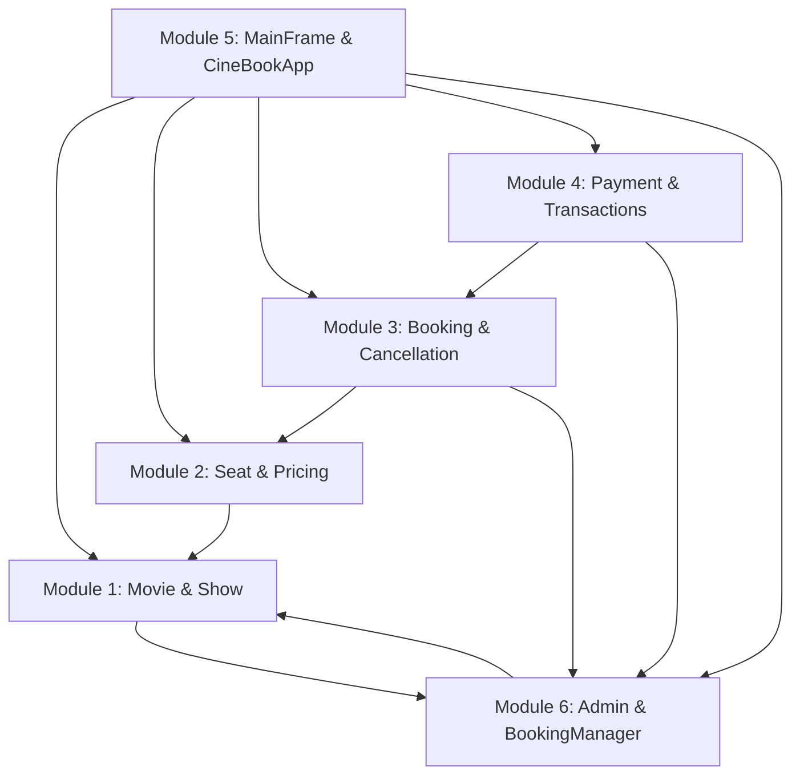

# CineBook — Movie Ticket Booking System
## Refactored Six-Member Modular Java Swing Desktop Application

CineBook is a desktop movie ticket booking system built using Java Swing and standard Java SE libraries. This codebase has been refactored into **six team modules** corresponding to the responsibilities of a six-member student project group.

---

## 1. Quick Start & Execution

The application uses a flat, package-free layout so that standard Java compiler dependency discovery works out of the box.

### Step 1: Open Terminal in Project Root
```bash
cd "c:\Users\Admin\Desktop\Joseph\OOP Project"
```

### Step 2: Compile the Entire Application
```bash
javac CineBookApp.java
```
*Compiling `CineBookApp.java` automatically discovers, resolves, and compiles all 44 modular source files.*

### Step 3: Run the Application
```bash
java CineBookApp
```
*Executes the 6-step regression verification suite in the console before launching the graphical interface.*

### Optional: Run Headless Verification Only (Automated Testing)
```bash
java CineBookApp --test-only
```

---

## 2. Six Team Member Modules & Source File Ownership

```
CineBook/
├── CineBookApp.java                  [Module 5: Entry point & test verification]
├── MainFrame.java                    [Module 5: Window frame & navigation]
├── UIConstants.java                  [Module 5: Common styling, fonts, colors]
│
├── Movie.java                        [Module 1: Movie domain model]
├── Screen.java                       [Module 1: Theater screen configuration]
├── Show.java                         [Module 1: Screening & showtime model]
├── MovieService.java                 [Module 1: Catalogue searching & CRUD]
├── MoviePanel.java                   [Module 1: Screen 1 movie browsing UI]
├── MovieDetailsPanel.java            [Module 1: Screen 2 show selection UI]
│
├── Seat.java                         [Module 2: Seat entity with pricing tier]
├── SeatStatus.java                   [Module 2: AVAILABLE, SELECTED, RESERVED, BOOKED]
├── SeatCategory.java                 [Module 2: STANDARD, PREMIUM, VIP tiers]
├── SeatManager.java                  [Module 2: Seat state transitions & expiry]
├── SeatSelectionPanel.java           [Module 2: Screen 3 interactive seating grid]
│
├── Booking.java                      [Module 3: Booking record model]
├── BookingStatus.java                [Module 3: PENDING, CONFIRMED, FAILED, CANCELLED]
├── Cancellable.java                  [Module 3: Cancellation contract interface]
├── BookingService.java               [Module 3: Reservation, confirmation & refund logic]
├── BookingHistoryPanel.java          [Module 3: Screen 6 my bookings & e-ticket modal]
├── BookingConfirmationPanel.java     [Module 3: Screen 5 confirmation receipt UI]
│
├── PaymentStatus.java                [Module 4: Payment status lifecycle enum]
├── PaymentMethod.java                [Module 4: Abstract payment strategy base]
├── MockCardPayment.java              [Module 4: Credit/Debit card simulation]
├── MockUpiPayment.java               [Module 4: UPI Instant pay simulation]
├── MockWalletPayment.java            [Module 4: Digital wallet simulation]
├── PaymentGateway.java               [Module 4: Payment gateway interface]
├── LegacyBankGatewayApi.java         [Module 4: Third-party legacy banking API]
├── LegacyBankResult.java             [Module 4: Legacy bank response structure]
├── LegacyBankGatewayAdapter.java     [Module 4: Adapter design pattern implementation]
├── PaymentTransaction.java           [Module 4: Financial ledger transaction record]
├── PaymentProcessor.java             [Module 4: Payment execution coordinator]
├── CheckoutPanel.java                [Module 4: Screen 4 checkout & outcome simulator]
│
├── User.java                         [Module 6: Base user authentication entity]
├── Customer.java                     [Module 6: Customer account profile]
├── AdminUser.java                    [Module 6: Administrator role profile]
├── BookingManager.java               [Module 6: Thread-safe singleton state manager]
├── AdminPanel.java                   [Module 6: Screen 7 management dashboard]
├── Searchable.java                   [Module 6: Generic search interface]
├── CineBookException.java            [Module 6: Base custom exception]
├── SeatUnavailableException.java     [Module 6: Seat conflict exception]
├── BookingNotFoundException.java     [Module 6: Missing booking exception]
├── InvalidBookingStateException.java [Module 6: State guard violation exception]
├── PaymentProcessingException.java   [Module 6: Payment failure exception]
└── ValidationException.java          [Module 6: Input validation / guard exception]
```

---

## 3. How the Six Modules Collaborate



1. **Shared State Access:** `BookingManager` (Module 6) serves as the in-memory Singleton. It owns the central collections of movies, screens, shows, bookings, users, and transactions.
2. **Browsing Flow (Module 1 $\rightarrow$ Module 2):** When a user browses movies via `MoviePanel` and selects a showtime in `MovieDetailsPanel`, `MainFrame` (Module 5) coordinates navigation to `SeatSelectionPanel` (Module 2).
3. **Seat Hold Flow (Module 2 $\rightarrow$ Module 3):** Clicking "Proceed to Checkout" in `SeatSelectionPanel` calls `BookingService.createPendingReservation(...)` (Module 3), which coordinates with `SeatManager` (Module 2) to lock selected seats into `RESERVED` state for 5 minutes.
4. **Checkout Flow (Module 3 $\rightarrow$ Module 4):** `MainFrame` transfers the pending `Booking` to `CheckoutPanel` (Module 4). `PaymentProcessor` executes the chosen strategy (`MockCardPayment`, `MockUpiPayment`, `MockWalletPayment`, or `LegacyBankGatewayAdapter`), creating a `PaymentTransaction` and invoking `BookingService.confirmBooking(...)` upon success.
5. **Cancellation & Expiry (Module 3 $\rightarrow$ Module 2):** When a booking is cancelled or a checkout timer expires, `BookingService` delegates to `SeatManager.releaseSeats(...)`, ensuring seats are immediately freed.
6. **Administration (Module 6):** `AdminPanel` interacts with `MovieService` and `BookingManager` to schedule shows, inspect bookings, and audit revenue without exposing internal mutable collections directly.

---

## 4. Key Object-Oriented Principles & Design Patterns

1. **Singleton Pattern (`BookingManager`):** Double-checked locking with a `volatile` reference ensures a single, thread-safe repository across all screens.
2. **Strategy Pattern (`PaymentMethod`):** Polymorphic `executeTransaction(amount)` allows dynamic runtime substitution of Card, UPI, and Wallet payment algorithms.
3. **Adapter Pattern (`LegacyBankGatewayAdapter`):** Implements `PaymentGateway` by adapting `LegacyBankGatewayApi`, converting legacy bank responses into standard `PaymentTransaction` models.
4. **Encapsulation & Data Hiding:** Model fields are `private final` where appropriate, using defensive copies and unmodifiable collections (`Collections.unmodifiableList`).
5. **Interface Segregation:** Distinct behavioral interfaces: `Cancellable`, `Searchable<T>`, and `PaymentGateway`.
6. **Defensive Concurrency & Safe Guards:** Synchronized booking operations prevent race conditions, and a safe deletion guard blocks movie deletion if active bookings exist.
7. **Recursion:** `countTotalBookedSeatsRecursive(...)` computes aggregate booked seat metrics over transactional object graphs.
